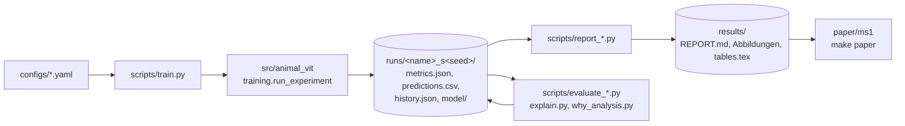
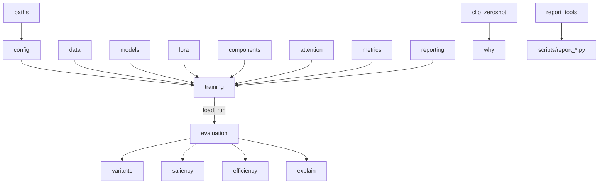
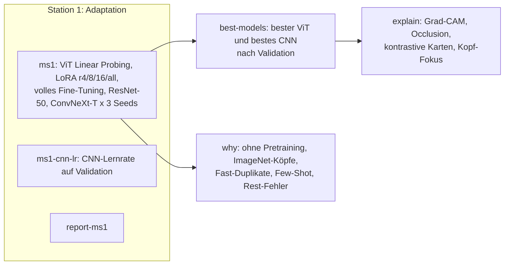

# Architektur

Wie das Repository aufgebaut ist, wie die Daten durch die Pipeline fließen und wo man was ändert.
Setup und Config-Schema stehen in [`TECHNICAL.md`](TECHNICAL.md), der fachliche Hintergrund in
[`CONTEXT.md`](CONTEXT.md).

## 1. Überblick

- **Eine Pipeline für alle Modelle.** ViT, ResNet und ConvNeXt laufen über
  `AutoModelForImageClassification` und denselben Hugging-Face-`Trainer`, mit identischem Protokoll.
- **Läufe sind die Schnittstelle.** Jeder Trainingslauf schreibt einen Ordner `runs/<name>_s<seed>/`.
  Alle Auswertungen lesen nur diese Ordner, nie interne Zustände.
- **Reports erzeugen Zahlen und Text.** `scripts/report_*.py` schreiben `results/<station>/REPORT.md`
  mit Tabellen, Abbildungen, geprüften Hypothesen und Befunden. Das Paper bindet `results/` ein.
- **`make` orchestriert alles** und überspringt fertige Läufe (`scripts/train_if_missing.sh`), damit
  abgebrochene GPU-Sitzungen einfach neu gestartet werden können.

## 2. Verzeichnisse

| Ordner | Inhalt | Git |
|---|---|---|
| `src/animal_vit/` | Python-Paket: Daten, Modelle, Training, Analysen | ✅ |
| `scripts/` | Kommandozeilen-Werkzeuge (Training, Auswertung, Reports, Setup) | ✅ |
| `configs/` | ein YAML pro Experiment: `ms1/`, `why/`, `extra/`, `debug.yaml` | ✅ |
| `tests/` | pytest, CPU, ohne Downloads (Mini-ViT aus `conftest.py`) | ✅ |
| `results/` | Reports, Abbildungen, Tabellen je Station + `summary.md` | ✅ (Bilder über LFS) |
| `paper/ms1` | Paper im CVPR-2026-Template (LaTeX, Deutsch) | ✅ |
| `docs/` | Kontext, Technik, Architektur, Anforderungen, Gliederungen, RunPod | ✅ |
| `data/` | Oxford-IIIT Pet (Download per `make data`) | ❌ |
| `runs/` | Trainingsläufe inkl. Gewichte | ❌ |

## 3. Paket `animal_vit`

| Modul | Aufgabe | Station |
|---|---|---|
| `paths.py` | alle Pfade (Repo, Daten, Läufe, Ergebnisse), Umgebungsvariablen | alle |
| `config.py` | Dataclasses `model`, `modifications`, `distillation`, `data`, `training`; YAML + `--set` | alle |
| `data.py` | Oxford-IIIT Pet (25 Hunderassen, Masken), stratifizierter Split, Transforms, `collate_fn` | alle |
| `models.py` | Hugging-Face-Klassifikatoren laden, `model_family`, `set_trainable` | alle |
| `lora.py` | LoRA-Adapter einsetzen und nach dem Training einrechnen | 1 |
| `training.py` | `ExperimentTrainer` (Cross Entropy), `run_experiment`, `load_run` | 1 |
| `clip_zeroshot.py` | Bild-Text-Merkmale (CLIP) für die Fast-Duplikat-Suche und Few-Shot-Kurven | why |
| `variants.py` | Testbild-Varianten: nur Hund, nur Hintergrund, fremder Hintergrund, Graustufen, Patch-Shuffle | 3 |
| `efficiency.py` | Parameter, GFLOPs, Latenz (Batch 1 und 32) | 1, 2 |
| `why.py` | ImageNet-Abgleich der Rassen, Nachbarsuche für Fast-Duplikate, eingefrorene Merkmale | why |
| `explain.py` | Grad-CAM (pytorch-grad-cam), Occlusion (Captum), kontrastive Karten, Kopf-Fokus, Deletion-Test | explain |
| `saliency.py` | Attention Rollout, Grad-CAM, Foreground Focus | explain |
| `metrics.py` | Accuracy, Macro-F1, Cross Entropy, ECE | alle |
| `reporting.py` | ausführliches Protokoll je Lauf (README, Lernkurven, Vorhersagen) | alle |
| `report_tools.py` | gepaarte Differenzen (`paired_delta`), Tabellen, Abbildungen, Dezimalkomma | Reports |
| `data_quality.py` | Datenqualität (Balance, Farbmodi, Größen, Duplikate, Anteil des Hundes) | 1 |
| `components.py`, `attention.py`, `style_transfer.py` | optionale Analysen (`configs/extra`, `make analysis`) | – |

## 4. Ablauf (Meilenstein 1)

`scripts/select_teacher.py` wählt das beste Modell **nur nach Validation-Accuracy** (Gleichstand →
kleinerer Validation-Loss) und schreibt `results/ms1/best_models.json`; `explain` und `why` nutzen es.

## 5. Ein Lauf im Detail

1. `scripts/train.py configs/ms1/vit_b16_lora_r4.yaml --set training.seed=2` lädt die YAML in
   `ExperimentConfig` (Tippfehler in Schlüsseln führen zu einem Fehler).
2. `run_experiment` baut Datensätze (`data.build_datasets`), Modell (`models` + `lora`/`components`),
   optional den Teacher (`load_run`) und den `ExperimentTrainer`.
3. Training mit Early Stopping; der beste Checkpoint wird **auf Validation** gewählt.
4. Einmalige Auswertung auf `test`: `metrics.json`, `predictions.csv`, `classification_report.csv`,
   Confusion Matrix, Lernkurven, `README.md` des Laufs; LoRA wird vor dem Speichern eingerechnet.
5. Spätere Analysen (`evaluate_variants`, `benchmark`, `explain`) laden den Lauf mit `load_run` und
   ergänzen Dateien im selben Ordner (`variants.csv`, `efficiency.json`).

## 6. Wo ändere ich was?

| Ich möchte … | Datei |
|---|---|
| ein neues Experiment | neue YAML in `configs/`, Ziel im `Makefile` |
| ein anderes Modell | `model.checkpoint` in der YAML (jeder HF-Bildklassifikator) |
| eine neue Anpassungsmethode | `src/animal_vit/` (wie `lora.py`) + Feld in `config.py` + Test |
| eine neue Auswertung pro Lauf | Skript in `scripts/`, liest `runs/<name>/` über `load_run` |
| eine neue Aussage im Report | `scripts/report_ms*.py`, Signifikanz über `report_tools.paired_delta` |
| Text oder Zahlen im Paper | `paper/ms*/sec/*.tex`; Tabellen kommen aus `results/ms*/tables.tex` |

## 7. Qualität

- `make test`: 70+ Tests auf der CPU, inklusive End-to-End-Lauf mit Mini-ViT und Ordner-Datensatz.
- `make lint`: `ruff` (Stil, Importe, Bugbear), Zeilenlänge 120.
- GitHub Actions (`.github/workflows/ci.yml`) führt beides bei jedem Push aus.
- `make smoke`: die komplette Pipeline auf einer Mini-Teilmenge in Minuten.
